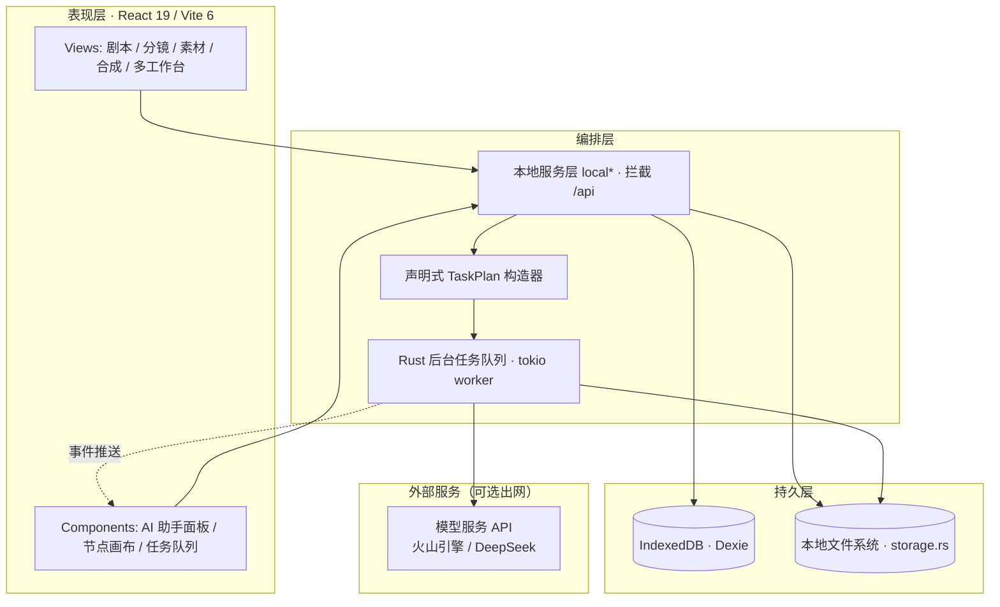

<div align="center">

# AI 视频编辑器（AI Video Studio）

**面向短视频创作的本地优先（Local-First）人工智能工作台**

*A Local-First AI-Native Workbench for Short-Video Production*

[](https://tauri.app/)
[](https://react.dev/)
[](https://www.typescriptlang.org/)
[](LICENSE)

</div>

---

## 摘要（Abstract）

AI 视频编辑器是一款基于 **Tauri v2 与 React 19** 构建的桌面端人工智能视频创作系统。系统采用**本地优先（local-first）**架构范式，将剧本生成、分镜设计、素材管理、视频合成与导出等创作环节整合为单一离线可运行的桌面应用：全部工程数据、媒体资产与异步任务状态均持久化于客户端本地，无需依赖任何服务端基础设施，亦不包含账号体系与计费逻辑。系统通过统一的能力槽位（capability slot）模型对接多模态与专用人工智能服务，并由 Rust 层托管的后台任务队列实现生成作业的持久化调度，使长耗时推理任务的执行独立于界面（WebView）生命周期。本设计在保障数据主权与离线可用性的同时，维持了对模型服务接口的可扩展适配能力。当前系统兼容**火山引擎（Volcengine Ark）**与 **DeepSeek** 两家模型服务。

## 1. 引言（Introduction）

传统云端视频创作平台普遍存在对服务端强耦合、用户数据离场上报、订阅制访问受限等问题。本系统据此确立三项核心设计目标：

1. **数据主权（Data Sovereignty）**——工程与素材全量驻留本地，除用户显式配置第三方模型接口外，不发生任何数据上行。
2. **离线可用性（Offline Availability）**——界面渲染、数据读写与任务调度不依赖网络可达性；网络仅在调用外部模型服务时被使用。
3. **可演进架构（Evolvable Architecture）**——以声明式能力抽象隔离厂商差异，支持在不改动上层工作流的前提下扩展模型与插件。

> 说明：本系统已由早期的 Web + 服务端架构重构为纯桌面本地应用，后端服务、数据库、账号鉴权、订阅计费、社区市场与管理后台等服务端组件均已移除。

## 2. 系统架构（System Architecture）

系统采用**表现层—编排层—持久层**三层解耦结构，前端（TypeScript）与桌面运行时（Rust）通过 Tauri IPC 边界通信，职责清晰分离。



### 2.1 表现层（Presentation Layer）
基于 React 19 与 HeroUI 组件体系，通过 React Router 7 组织多工作台视图；时间轴编辑、3D 预览与草图绘制分别由 FFmpeg.wasm、Three.js 与 Excalidraw 承载。

### 2.2 编排层（Orchestration Layer）
- **本地服务层（`services/local*.ts`）**：在客户端拦截原 `/api` 请求并路由至本地实现（`localApiRouter`、`localWorkflowRouter`），使上层业务代码与网络后端解耦，是本地优先范式的关键适配点。
- **任务编排（TaskPlan）**：前端将生成请求编排为厂商无关的声明式 `TaskPlan`（提交→轮询→退避重试→成品落地→事件推送）。
- **Rust 托管队列（`queue.rs`）**：由 tokio 后台 worker 执行通用 HTTP 调度与并发闸控，独立于 WebView 生命周期，实现任务的持久化与断点续跑。

### 2.3 持久层（Persistence Layer）
采用 **Dexie（IndexedDB）** 承载结构化工程数据，**本地文件系统（`storage.rs`）** 管理 `database / projects / media / cache / exports` 目录，二者共同构成客户端侧数据底座。

## 3. 功能体系（Functional Scope）

| 功能域 | 关键能力 |
|:-------|:---------|
| 剧本工作室 | AI 剧本生成、多集管理与自动编号、大纲面板、参考素材复用 |
| 分镜系统 | 一键自动拆分分镜、首/尾帧图像生成、AI 视频片段生成、简化分镜与导演空间 |
| 多工作台 | 短剧 / 漫画 / 小说 / 短视频四类工作台，节点式可视化工作流（Node Mode） |
| 资产管理 | 角色 / 场景 / 道具 / 服装分类管理、状态图与三视图参考、AI 图像生成 |
| 视频合成 | 多轨道时间轴、字幕与样式、BGM 音轨、基于 FFmpeg.wasm 的本地导出 |
| AI 助手 | 上下文感知的"规划→执行→观察"智能体循环，编码智能体风格的任务步骤流反馈 |
| 平台特性 | 本地任务队列、模型自由配置、扩展插件系统、国际化（zh-CN / en-US）、命令面板与新手引导 |

## 4. 模型能力抽象（Capability Model）

系统将模型接口归一为**文本 / 多模态 / 图像 / 视频 / 音频**五类能力槽位，当前**仅兼容火山引擎（Volcengine Ark）与 DeepSeek 两家模型服务**，通过本地模型配置接入，并以**静态能力映射与保守兜底**策略处理跨槽位复用：

| 能力槽位 | 服务商 · 代表模型 |
|:---------|:-----------------|
| 文本 / 剧本生成 | DeepSeek（V3 等）；火山引擎 · 豆包 Doubao |
| 多模态分析 | 火山引擎 · 豆包多模态（Doubao-Vision）——**可承担纯文本任务**（如分镜拆分） |
| 图像生成 | 火山引擎 · Seedream |
| 视频生成 | 火山引擎 · Seedance |
| 语音 / 音频 | 火山引擎 · 豆包语音（TTS） |

> 设计要点一：文本任务槽位同时接受 `TEXT` 与 `MULTIMODAL` 模型；在仅配置多模态大模型的场景下，剧本生成与分镜拆分等文本工作仍可正常执行，避免因严格类型过滤导致的可用性缺失。
>
> 设计要点二：两家服务均通过 OpenAI 兼容协议接入，但系统仅针对**火山引擎与 DeepSeek** 完成适配与验证，不保证其他第三方兼容接口的可用性。

## 5. 技术栈（Technology Stack）

### 5.1 前端运行时（`frontend/`）
| 技术 | 版本 | 职责 |
|:-----|:----:|:-----|
| React | 19 | 视图框架 |
| Vite | 6 | 构建与开发服务 |
| TypeScript | 5.8 | 静态类型系统 |
| TailwindCSS | 4 | 样式方案 |
| HeroUI | 2.8 | 组件库 |
| Framer Motion | 12 | 动效引擎 |
| React Router | 7 | 路由 |
| Dexie | 4 | IndexedDB 数据访问 |
| FFmpeg.wasm | 0.12 | 客户端视频处理 |
| Three.js | 0.184 | 三维渲染 |
| Excalidraw | 0.18 | 白板 / 草图 |

### 5.2 桌面运行时（`frontend/src-tauri/`，Rust）
| 模块 | 职责 |
|:-----|:-----|
| `commands.rs` | 工程 CRUD、媒体导入、AI 代理请求、模型请求签名注入、文件下载落地 |
| `queue.rs` | Rust 托管异步任务队列（持久化、轮询、退避重试、事件推送） |
| `storage.rs` | 本地数据目录结构管理 |

## 6. 构建与部署（Build & Deployment）

### 6.1 环境要求
| 依赖 | 版本 | 用途 |
|:-----|:----:|:-----|
| Node.js | 20+ | 前端构建 |
| Rust | stable | Tauri 桌面壳编译（Windows 需 `x86_64-pc-windows-msvc` 工具链） |
| Windows | 10 / 11 | 生成 `.msi` / `.exe` 安装包（仅打包阶段需要） |

### 6.2 快速开始
```bash
git clone https://github.com/songdiyang/AI-Video-Studio.git
cd AI-Video-Studio
npm --prefix frontend install      # 实际工程位于 frontend/
npm run tauri:dev                  # 开发模式运行桌面客户端
```

根目录 `package.json` 为仓库级编排入口，命令统一委托 `frontend/` 执行：

```bash
npm run tauri:dev             # 开发模式运行
npm run tauri:build:windows   # 构建 Windows 安装包（.msi + .exe）
npm run build                 # 仅构建前端产物（extensions + type-check + vite build）
```

### 6.3 产物与持续集成
安装包输出于 `frontend/src-tauri/target/x86_64-pc-windows-msvc/release/bundle/{msi,nsis}/`。GitHub Actions（`.github/workflows/build-windows-setup.yml`）在 `main` 推送与标签事件时自动构建：

- 构建产物以**北京时间日期**（`yyyyMMdd`）命名（如 `windows-setup-20261021`），安装包文件名同步注入日期；
- 推送 `v*` 标签时自动创建 Release 并附 `.msi` 与 `.exe`；
- 受 Tauri/WiX 约束，MSI 内部版本须满足 semver 与数值上限，故日期仅注入文件名而不改动内部版本。

## 7. 数据治理与隐私（Data Governance & Privacy）

系统遵循本地优先原则：工程、素材、模型配置与任务队列均存储于客户端本地磁盘与 IndexedDB，不向自建服务端上传任何数据。唯一网络上行发生于用户**显式配置并调用**的第三方模型接口，其数据流向由用户自主决定。

## 8. 目录结构（Repository Layout）

```
AI-Video-Studio/
├── package.json                 # 仓库级编排入口（委托 frontend/）
├── frontend/                    # Tauri + React 应用（实际工程）
│   ├── App.tsx / index.tsx      # 应用入口
│   ├── components/              # 公共组件（AI 助手面板 / 节点画布 / 任务队列 ...）
│   ├── views/                   # 页面模块（剧本 / 分镜 / 素材 / 合成 / 多工作台 ...）
│   ├── features/NodeMode/       # 节点式可视化工作流
│   ├── services/                # 数据层：local* 本地拦截 /api，Dexie + Tauri FS 落地
│   ├── hooks/ contexts/ utils/ types/ locales/ notifications/
│   └── src-tauri/               # Tauri 桌面壳（Rust）
│       ├── src/{commands,queue,storage,lib,main}.rs
│       ├── capabilities/        # 权限声明
│       └── tauri.conf.json      # 打包 / 窗口 / 文件关联配置
├── extensions/japanese-language-pack/   # 内置示例插件
├── scripts/                     # 扩展打包与资源工具
├── docs/                        # 项目文档
└── .github/workflows/           # CI：Windows 安装包自动构建
```

## 9. 许可协议（License）

本系统基于 **自定义非商用许可协议（Jiaozi Anime Custom License – Non-Commercial）** 发布，**仅授予个人学习、研究与教育用途的使用权限，明确禁止任何商业用途**。完整条款详见 [LICENSE](LICENSE)。

---

<div align="center">

© songdiyang · 版权所有

</div>
